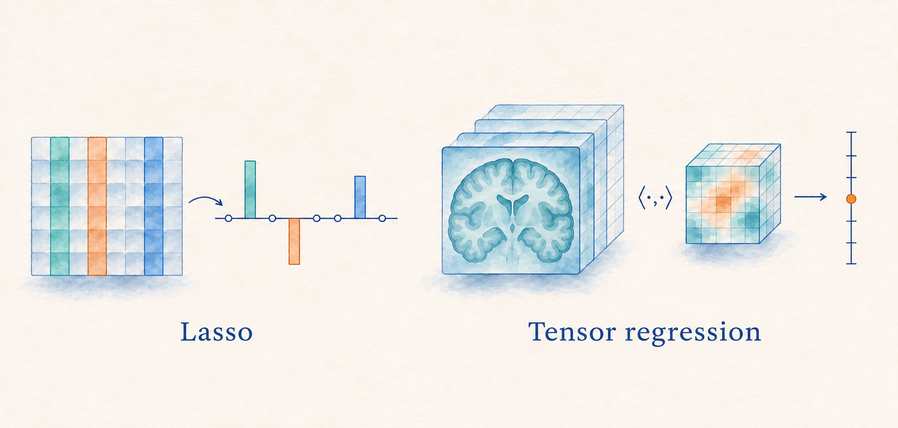

## Course overview

This course introduces regression analysis and data thinking, from formulating research questions to estimation, inference, prediction, and causal interpretation. Topics include linear regression, model diagnostics, generalized linear models, quantile and tail-risk regression, panel data, fixed effects, difference-in-differences, and factor models. The course also covers high-dimensional regression, variable selection, regularization, dimension reduction, multivariate regression, and tensor regression.

{.course-overview-image}

## Course materials

*Course materials will be continuously updated throughout the course.*

### Lecture 1: High-Dimensional Linear Regression and Regularization

::: lecture-downloads
[Open the slides (PDF)](course-materials/asta6002/ASTA6002-01-high-dimensional-regression.pdf){.btn .btn-outline-primary .slides-download target="_blank" rel="noopener"}
:::

## Course schedule

<table>
<thead>
<tr><th>Week</th><th>Date</th><th>Topics</th><th>Slides / module</th></tr>
</thead>
<tbody>
<tr><td>1</td><td>Nov 4</td><td><ul><li>Ridge and Lasso</li><li>Best subset selection</li><li>Optimization and cross-validation</li></ul></td><td>1</td></tr>
<tr><td>2</td><td>Nov 11</td><td><ul><li>Variable-selection theory</li><li>Elastic Net and adaptive Lasso</li><li>Structured penalties</li></ul></td><td>2</td></tr>
<tr><td>3</td><td>Nov 18</td><td><ul><li>Penalized likelihood</li><li>IRLS and coordinate descent</li><li>Regularized GLMs</li></ul></td><td>3</td></tr>
<tr><td>4</td><td>Nov 25</td><td><ul><li>Principal component regression</li><li>SIR and SAVE</li><li>Sufficient dimension reduction</li></ul></td><td>4</td></tr>
<tr><td>5</td><td>Dec 2</td><td><ul><li>Multivariate regression</li><li>Reduced-rank regression</li><li>Sparse and low-rank models</li></ul></td><td>5</td></tr>
<tr><td>6</td><td>Dec 9</td><td><ul><li>Tensor regression</li><li>CP and Tucker decompositions</li><li>Optimization and regularization</li></ul></td><td>6</td></tr>
</tbody>
</table>

