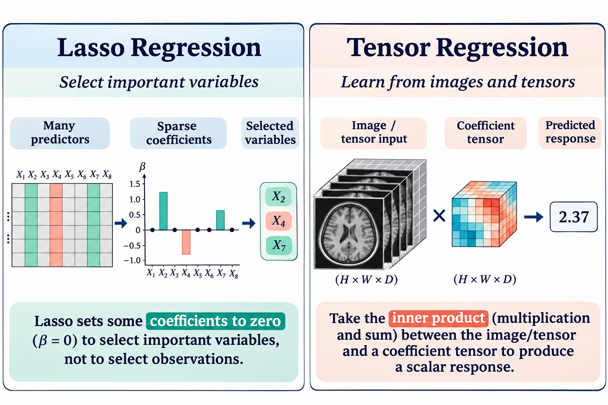

## Course overview

This course develops regression analysis and data thinking through high-dimensional regression, variable selection, regularization, dimension reduction, and structured models for multivariate and tensor responses. Case studies, derivations, and classroom exercises connect statistical modeling with computational methods.

{.course-overview-image}

## Course materials

*Course materials will be continuously updated throughout the course.*

### Lecture 1: High-Dimensional Linear Regression and Regularization

Starting with the limitations of least squares in high dimensions, this lecture introduces Ridge regression, best subset selection, and Lasso, followed by soft thresholding, coordinate descent, proximal gradient methods, regularization paths, and cross-validation.

::: lecture-downloads
[Open the slides (PDF)](course-materials/asta6002/ASTA6002-01-high-dimensional-regression.pdf?v=478afac5c2e5){.btn .btn-outline-primary .slides-download target="_blank" rel="noopener"}
:::
## Course schedule

The course consists of six lectures, each spanning four 45-minute class periods (24 class periods in total). The tentative schedule includes derivations, classroom exercises, and discussion; topics may be adjusted as the course progresses. Class dates will be announced separately.

<table>
<thead>
<tr><th>Lecture</th><th>Class periods</th><th>Planned topics</th><th>Slides / module</th></tr>
</thead>
<tbody>
<tr><td>1</td><td>1–4</td><td>High-dimensional regression and Ridge; best subset selection and Lasso; optimization and regularization paths; tuning and case studies</td><td><a href="course-materials/asta6002/ASTA6002-01-high-dimensional-regression.pdf?v=478afac5c2e5" target="_blank" rel="noopener">Lecture 1 slides</a></td></tr>
<tr><td>2</td><td>5–8</td><td>Prediction and variable-selection theory; Elastic Net and adaptive weights; structured and nonconvex penalties; inference and selected research topics</td><td>Variable Selection and Structured Regularization</td></tr>
<tr><td>3</td><td>9–12</td><td>Penalized likelihood and KKT conditions; IRLS and coordinate descent; count models and structured penalties; inference and research extensions</td><td>Regularized GLMs and Variable Selection</td></tr>
<tr><td>4</td><td>13–16</td><td>Principal component regression (PCR); central subspaces and sliced inverse regression (SIR); SAVE and implementation diagnostics; high-dimensional sufficient dimension reduction</td><td>PCR and Sufficient Dimension Reduction</td></tr>
<tr><td>5</td><td>17–20</td><td>Multivariate regression and low-rank assumptions; reduced-rank regression; group sparsity, nuclear norm penalties, and penalized matrix decomposition; evaluation and research discussion</td><td>Multivariate Regression and Low-Rank Structure</td></tr>
<tr><td>6</td><td>21–24</td><td>Tensor notation and regression objectives; CP and Tucker decompositions; parameter counts and identifiability; block optimization and regularization; limitations and research discussion</td><td>Tensor Regression</td></tr>
</tbody>
</table>

